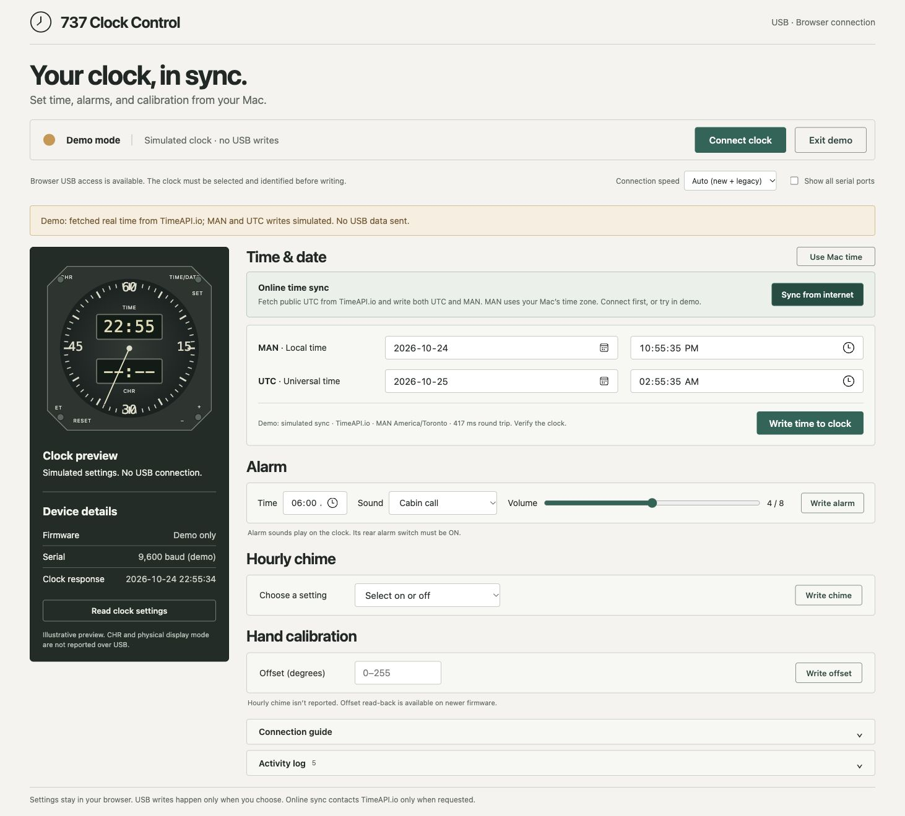

# B737 Clock Control · v1.1.0

**New in v1.1.0:** one-click [online time sync](docs/ONLINE_TIME_SYNC.md) sets both MAN and UTC using public HTTPS time. Existing Mac-time and manual controls remain available.

Control an **Aviation 1 Boeing 737 NG replica clock** from a Mac using desktop Chrome or Edge and a USB data cable. No Windows application or USB connection helper is needed. The browser talks directly to the clock through Web Serial.

**[Download v1.1.0 for Mac](https://github.com/B1ackCat7/b737-clock/releases/tag/v1.1.0)** · **[Clock operating guide](docs/USER_GUIDE.md)** · **[Troubleshooting](docs/USER_GUIDE.md#troubleshooting)** · **[Protocol](docs/PROTOCOL.md)**

This release adds online time sync to the existing USB controls. The project owner tested the update, reported it working, and approved publication. This is an independent utility for a consumer replica; it is not Boeing software or certified aircraft equipment.



## Start on a Mac

1. Download **737-clock-mac-v1.1.0.zip** from the release above and unzip it.
2. Open **Start Clock Portal.command** in the extracted folder. Python 3 must be installed and available as `python3`. Leave the Terminal window open; the launcher opens Chrome or Edge at `http://127.0.0.1:7370`.
3. Connect the clock using a **USB data cable**, turn its rear **POWER** switch **ON**, and check that its display is lit. Close other software using its serial port.
4. Select **9,600 baud · legacy** for the tested legacy clock, or **Auto** if unsure. Click **Connect clock** and select the clock's USB Serial device in the browser chooser.
5. Wait for **Connected**. Click **Sync from internet** to fetch public UTC and set both MAN and UTC, or use **Use Mac time** / manual entry followed by **Write time to clock**. Other settings keep their own Write buttons. Connecting alone does not change settings.

If macOS blocks the downloaded command file, review the source and run `python3 launcher.py` from the extracted folder in Terminal. Do not disable macOS security protections. Stop the server with **Control-C**. Full prerequisites and alternative launch steps are in the [guide](docs/USER_GUIDE.md#open-the-tool-on-a-mac).

**Try demo** works without a connected clock. Every demo operation is simulated. Safari and Firefox do not provide the Web Serial API required by this release; use desktop Chrome or Edge for USB access. Phone screenshots demonstrate layout only.

## Controls

| Setting | Behavior |
| --- | --- |
| Online time sync | One click fetches public UTC from TimeAPI.io and writes MAN and UTC; MAN uses the Mac time zone |
| MAN and UTC time/date | Prepare both from the Mac's clock, or edit separately; one button sends two successive writes |
| Alarm | Time, sound IDs 0–7, volume 0–8; sound 0 mutes the alarm |
| Hourly chime | Explicit on/off selection; current state is not reported |
| Hand calibration | Raw offset byte 0–255; physical scale/direction not verified |
| Device information | Reported timestamp and alarm settings; firmware/offset only where returned |
| Activity log | Session-only diagnostics, with manual JSON export |

Auto detection tries 57,600 then 9,600 baud. The parser supports 11-, 18-, and 31-byte settings layouts. Legacy devices may legitimately show **Not reported (legacy)** for firmware. CHR/ET operation, physical display selection, audio playback, and firmware flashing are outside this browser tool; use the [physical clock instructions](docs/USER_GUIDE.md#operate-the-physical-clock).

## Verification and limits

A physical legacy clock was read successfully at **9,600 baud**. Its existing alarm values were written back unchanged, acknowledged, and confirmed by a further read. The project owner tested the online-sync update and reported it working before this release. Independent timing-accuracy measurements were not recorded. Chime and calibration effects remain physically unverified. Newer 57,600-baud hardware is not covered by that physical test. Browser device selection requires user permission; the complete browser-to-hardware write path has not been verified in automation.

All **28 automated tests** passed. See [release validation](docs/VALIDATION.md) for the evidence boundary. A matching acknowledgement confirms protocol acceptance, not necessarily the resulting audible or mechanical behavior. Review the clock after a change. An uncertain write disconnects the app and is not automatically retried.

## Run from source

```sh
git clone https://github.com/B1ackCat7/b737-clock.git
cd b737-clock
python3 -m http.server 7370 --bind 127.0.0.1 --directory dist
```

Open `http://127.0.0.1:7370` in desktop Chrome or Edge. Opening `index.html` as a file is not supported. No npm installation or compilation is required.

```sh
# Node.js 20 or later
node --test tests/*.test.js
# Python 3: rebuild the same Mac download used by a static host
python3 build_mac_download.py
```

The browser files live in `dist/`. To host your own copy, build the Mac ZIP first, then serve `dist/` as a static website over **HTTPS**, opened as a top-level page. No backend or account system is required. Hosting a page does not allow remote access to a clock attached to another computer. The local launcher uses Python only to serve files on loopback; it never opens USB.

## Manuals, attribution, and rights

The [operating guide](docs/USER_GUIDE.md) paraphrases the supplied replica manuals and identifies their printed panels. [Sources](docs/REFERENCES.md) links Boeing's official licensed FCOM access and explains the scope of the seller's historical FCOM excerpt. A current licensed Boeing clock chapter was not independently accessed for this release.

Vendor software, firmware, manual PDFs, raw disassembly, device logs, and private hosting configuration are not distributed here. Boeing and 737 are trademarks of The Boeing Company. This project is not affiliated with Boeing or the replica manufacturer. No open-source license has been selected for v1.1.0; public visibility alone does not grant an open-source license.
